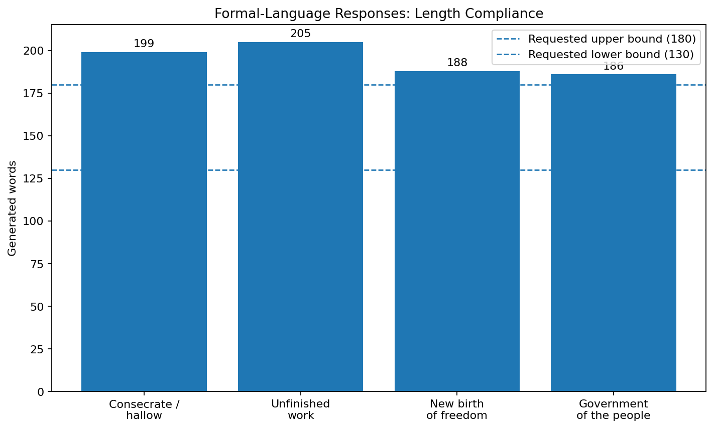
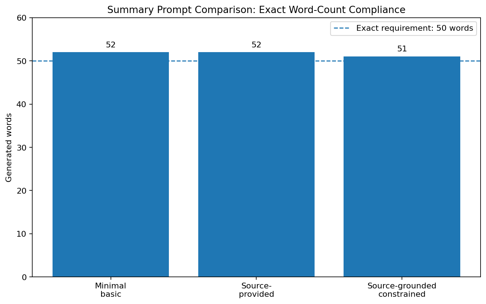
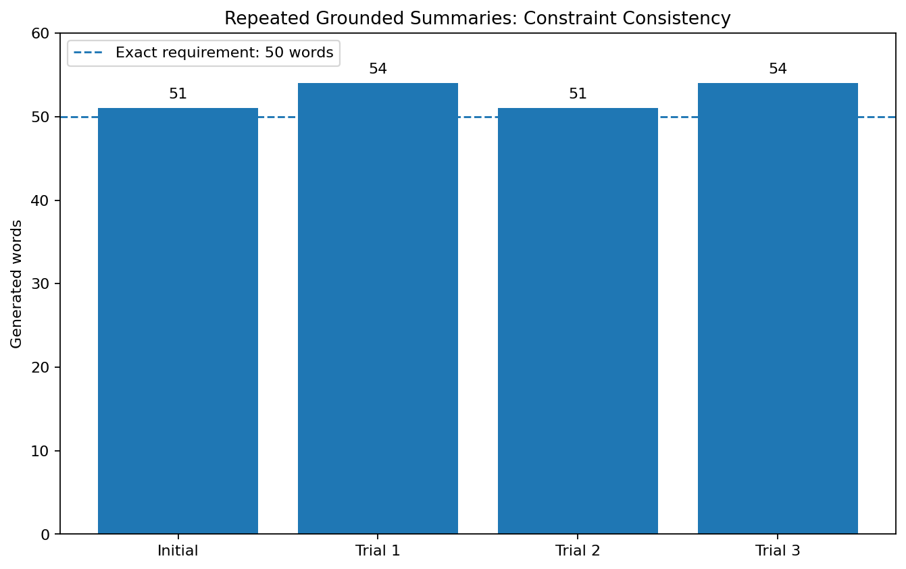
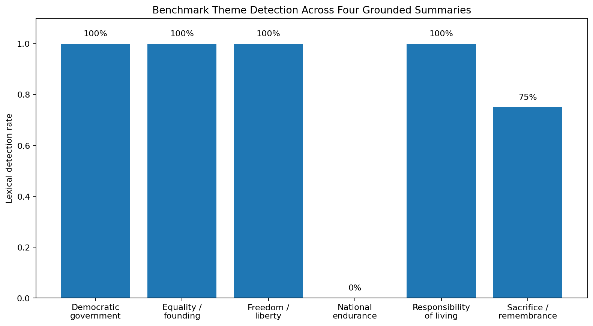
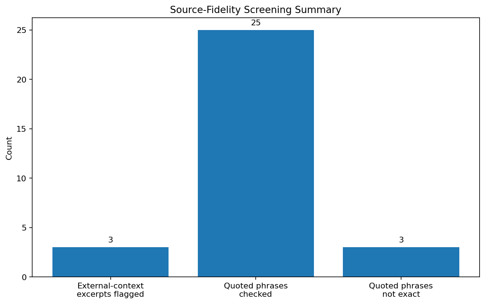
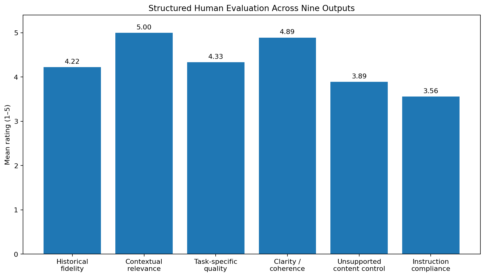

# Generative AI & NLP Evaluation

An executed NLP case study evaluating a GPT-like model on **source-grounded historical-text interpretation, constrained summarization, prompt design, quotation fidelity, output variability, and structured human review** using Abraham Lincoln's *Gettysburg Address*.

**Author:** Roxanne Lyle  
**Stack:** Python · OpenAI API · pandas · NLP evaluation  
**Executed model:** `gpt-5-mini`  
**Authoritative source:** National Park Service version of the *Gettysburg Address*

> Fluent output is not treated as proof of factual accuracy or human-like understanding. Findings are limited to the selected model, source, prompts, and executed trials.

## Project Question

How reliably can a GPT-like model interpret and summarize a historically important source text when evaluation separates **fluency** from **source fidelity, instruction compliance, quotation accuracy, and unsupported-content control**?

## Experimental Design

The preserved execution completed **12 successful API requests** across several tasks:

- opening-passage interpretation;
- four formal-language explanations;
- source-grounded theme identification;
- three summary-prompt conditions;
- three additional repeated grounded-summary trials.

The authoritative source contained **272 words**. Across the 12 successful requests, the experiment logged **1,962 generated output words** and a mean request latency of **3.735 seconds**.

Evaluation combined automated screening with structured human review rather than relying on fluent prose alone.

## Formal-Language Interpretation

Four historical-language prompts were successfully completed, but **0 of 4** satisfied the requested **130–180-word** range.



Observed lengths were **186, 188, 199, and 205 words**. This matters because a model can produce relevant content while still failing an explicit numerical instruction.

## Prompt Design and 50-Word Summarization

Three primary summarization conditions were compared:

1. a minimal prompt without the source text;
2. a source-provided prompt;
3. a source-grounded constrained prompt with explicit thematic and evidence instructions.

All three produced complete summaries, but their lengths were **52, 52, and 51 words**.



Therefore, **0 of 3** satisfied the exact 50-word requirement.

The comparison is descriptive rather than causal because the prompt conditions differ in more than one way: source availability, instruction detail, thematic guidance, and evidence restrictions all change simultaneously.

## Repeated-Trial Variability

The grounded summary was evaluated across the initial output plus three repeated trials.



Key executed findings:

- Successful grounded-summary outputs: **4**
- Exact 50-word outputs: **0**
- Exact-compliance rate: **0%**
- Mean word count: **52.5**
- Observed range: **51–54 words**
- Unique output texts: **4 of 4**
- Mean pairwise sequence similarity: **0.252**
- Mean lexical Jaccard similarity: **0.472**

The outputs were not exact textual repeats. They showed substantial wording variation while preserving moderate vocabulary overlap.

## Theme-Coverage Screening

A six-theme benchmark was used as a lexical screening tool. In the dedicated theme-analysis task, **6 of 6 benchmark themes were detected lexically**.

Across the four grounded-summary outputs, lexical detection was more variable:



Four themes appeared in all four grounded summaries, one appeared in three of four, and one was not detected by the lexical screen.

These indicators are **screening evidence, not semantic proof**. Absence of a keyword pattern does not establish absence of the underlying idea, and presence of a matching phrase does not prove correct historical interpretation.

## Source Fidelity and Quotation Verification

The evaluation explicitly screened generated outputs for selected external-context terms and checked quoted phrases against the authoritative source.



Across the preserved outputs:

- **3 external-context excerpts** were flagged for review;
- **25 quoted phrases** were checked;
- **22 matched** the authoritative source after normalization;
- **3 did not match exactly**.

The flagged external-context excerpts were not automatically labeled false. They were marked for human verification because they introduced historical claims not stated directly in the supplied source.

One of the strongest observed limitations occurred in the analysis of **“new birth of freedom”**, where the response combined interpretive expansion, altered quotation, and an inaccurate statement about its own evidence boundary.

## Structured Human Evaluation

Nine generated outputs were evaluated across six criteria on a 1–5 scale.



| Criterion | Mean rating |
|---|---:|
| Historical fidelity | 4.22 |
| Contextual relevance | **5.00** |
| Task-specific quality | 4.33 |
| Clarity and coherence | **4.89** |
| Unsupported-content control | 3.89 |
| Instruction compliance | **3.56** |

The overall mean across all six criteria and nine evaluated outputs was **4.31 / 5**.

The **source-provided summary** received the highest output mean at **4.83 / 5**. The **“new birth of freedom”** analysis received the lowest at **3.67 / 5**.

The pattern is important: the model was consistently relevant and readable, but less dependable when exact constraint compliance and evidence-boundary discipline were required.

## What the Experiment Demonstrated

The executed evidence supports several practical conclusions:

- **Fluency and reliability are different properties.**
- Source grounding provides a clearer evidence boundary but does not guarantee perfect compliance or quotation fidelity.
- Exact numerical constraints can fail even when the semantic task is completed successfully.
- Repeated generation produces non-identical outputs, so single-response evaluation can hide variability.
- Automated lexical checks are useful screening tools but require human interpretation.
- Historical or research-oriented NLP workflows benefit from explicit source verification and human review.

## Responsible Use

Reasonable applications include educational reading support, archival description assistance, public-history communication, accessibility-focused paraphrasing, and research support **when outputs are reviewed against authoritative sources**.

Higher-risk uses require stronger safeguards. Generated historical claims should not be treated as archival evidence, and quotations should be verified before publication or citation.

## Limitations

- One GPT-like model was evaluated.
- One short historical document was used.
- The prompt set was limited.
- Human evaluation was completed by one reviewer.
- The prompt-comparison conditions were not a controlled causal experiment.
- Lexical theme checks can miss semantically valid paraphrases or overcount shallow phrase matches.
- External-context screening searched selected terms rather than all possible unsupported claims.
- The experiment does not establish performance on other documents, domains, or models.

## Reproducibility and Security

The notebook includes reusable API functions, a run log, source metadata, automated screening utilities, and preserved generated responses.

The API credential is read through secure environment-variable / hidden-input handling and is **not printed in the notebook**. The GitHub-ready notebook contains no embedded API secret.

To reproduce the workflow:

```bash
pip install -r requirements.txt
jupyter notebook generative_ai_nlp_evaluation_case_study.ipynb
```

A valid OpenAI API key and access to a compatible model are required to make new API requests. New executions may produce different text, latency, or model-specific behavior.

## Repository Contents

- `generative_ai_nlp_evaluation_case_study.ipynb` — executed professional case-study notebook
- `requirements.txt` — Python dependencies
- `.gitignore` — common local artifacts excluded from version control
- `formal_language_word_counts.png`
- `summary_prompt_word_counts.png`
- `repeated_trial_word_counts.png`
- `grounded_summary_theme_detection.png`
- `human_evaluation_criteria.png`
- `source_fidelity_screening.png`

## References

- Lincoln, A. (1863). *Gettysburg Address*. National Park Service authoritative transcription.
- Lin, S., Hilton, J., & Evans, O. (2022). TruthfulQA: Measuring how models mimic human falsehoods. *Proceedings of the 60th Annual Meeting of the Association for Computational Linguistics*.
- Radford, A., Narasimhan, K., Salimans, T., & Sutskever, I. (2018). *Improving language understanding by generative pre-training*.
- Vaswani, A., et al. (2017). Attention is all you need. *Advances in Neural Information Processing Systems, 30*.
